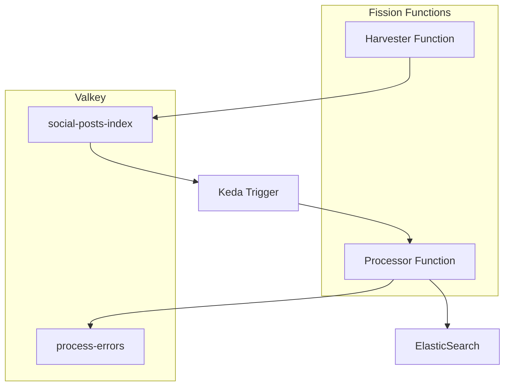

# Data Processing Functions

Version **0.2.0**. Queue consumers are thin adapters around the `processing`
package. `indexer.py` checks destination deduplication markers before costly
normalization/inference and repairs partial deliveries independently.
`census_io.py` owns shapefile iteration, batched queue delivery and bulk upserts;
`process_census.py` owns record extraction.

Install the optional `census` extra to read shapefiles. Run `python -m pytest`
in this directory using the prepared workspace environment. See the
[ingestion guide](../../docs/ingestion.md) for commands and delivery semantics.

## Overview
This package contains Fission function for processing the raw data received from out social media sources. The function will be triggered when data is pushed to a given queue on Valkey (drop-in Redis replacement). It will do necessary transformations on the data and then load it to our ElasticSearch index for social media data. General workflow is as follows:



## Requirements
In order to process data, it must come in this format:
```json
{
  "source": "mastodon|bluesky|etc.",
  "data": {"your":  "data"}
}
```
To integrate a new data source, you must create the following code:
1. In [`schemas.py`](./src/processing/schemas.py), add a `BaseModel` with just a literal `source` field and a `data` field to hold your data. This will be used as a selector to determine the appropriate processor for the raw data.
2. Add a new function to process the data above and insert it into ElasticSearch. It should receive the raw data and an elasticsearch client for insertion. Call the function in [`consumer.py`](./src/consumer.py) at the appropriate place to process data from your specific provider.
